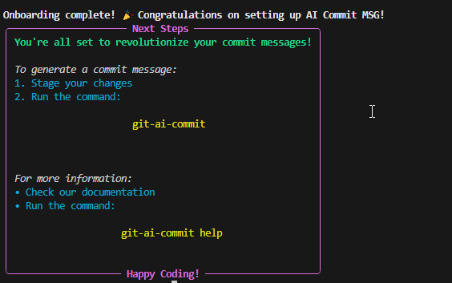

# AI GIT Commit Messages -  Locally-Hosted Options

## Table of Content

- [AI GIT Commit Messages -  Locally-Hosted Options](#ai-git-commit-messages----locally-hosted-options)
  - [Table of Content](#table-of-content)
  - [Prerequisites](#prerequisites)
  - [Setting up Ollama](#setting-up-ollama)
  - [Installing Large Language Models](#installing-large-language-models)
    - [Pull and Run LLMs with Ollama CLI (Mistral)](#pull-and-run-llms-with-ollama-cli-mistral)
  - [Ollama for Git Commit Message Generation with Bash script](#ollama-for-git-commit-message-generation-with-bash-script)
  - [Ollama Git Commit with Helper packages](#ollama-git-commit-with-helper-packages)
  
In [Article 1](../Article1/index.md), we introduced three AI tools you can use to generate Git commit messages with large language models such as OpenAI's GPT and Anthropic's Claude - each required server access and authentication.

For example, Microsoft Copilot needed you to authenticate sessions with your GitHub credentials. Alternative third-party packages required that you obtain an API key from supported LLM providers and were limited by API request and token usage restrictions.

Now you'll learn how to set up and use large language models locally for generating Git commit messages without restrictions.

We'll install Ollama and configure models to work with Git using a custom script. We'll also use helper packages with Ollama access in a typical development environment. Both methods can be used to generate commit messages in your project without an internet connection.

> **Important**: It is crucial to note that containerized LLMs can be quite sizeable and resource-intensive. However, having them run locally instead of querying their cloud-hosted versions offers room for enhanced accessibility, flexibility, and control.

## Prerequisites

## Setting up Ollama

Ollama is a popular open-source tool that lets you host and run large language models locally.

To begin, install Ollama on your device.

- Visit the official [Ollama download webpage](https://ollama.com/download) and download the application for your operating system.

    

- Run **OllamaSetup.exe** (Windows)

After installation, run Ollama by clicking the Ollama icon on the Windows Start menu.

Make sure Ollama is running in the background. You can confirm this by looking up the following address in your browser:

```sh
http://127.0.0.1:11434
```


or this command in your terminal.

```sh
$ curl http://127.0.0.1:11434  
```

You can also use the _Invoke-RestMethod_ in PowerShell to confirm that Ollama is running.

```sh
$ Invoke-RestMethod http://127.0.0.1:11434
```

## Installing Large Language Models

Now that you have Ollama downloaded and running, the next step is to install Ollama-compatible models.

You can install language models on Ollama using the Ollama CLI, which directly downloads models from the [Ollama library](https://ollama.com/library).

Since our objective here is primarily to summarize and generate text based on code version differences, we'll use [**Mistral**](https://ollama.com/library/mistral), a relatively light weight language model popular its for text-generating capabilities.

### Pull and Run LLMs with Ollama CLI (Mistral)

To install (pull) and run Mistral, execute the following commands in your terminal:

```bash
$ ollama pull mistral
$ ollama run mistral
```

The same commands apply to all models listed in the Ollama model library. Replace `mistral` with the model name you wish to install and run.


Once the install process completes, you'll see success returned in the terminal.

Enter `/?` in the command line to show all available Ollama commands

You can then begin interacting with Mistral. Try doing this with and without an internet connection.


Ollama is preconfigured to utilize CPUs for prompt processing and response by default. This means model response rates can vary. Responses can be slow if your PC's CPU does not meet the minimum required threshold. It is recommended that, if available, you leverage GPUs to [elevate Ollama performance](https://docs.ollama.com/gpu).

## Ollama for Git Commit Message Generation with Bash script

Before configuring Ollama to work with Git, ensure that you have either **git bash** or **WSL** terminal integrated in your IDE.


Proceed with the following steps:

1. At the root of your project, create a new Bash script `mistral-ai-commit.sh`.

    The code below generates concise commit messages using staged changes in your git repository. This is the content of your bash script.

    ```bash
    #!/bin/bash  

    # Gets the current branch name  
    branch_name=$(git symbolic-ref --short HEAD)  

    # Gets the current user name  
    user_name=$(git config user.name)  

    # Gets the status messages  
    git_diff=$(git diff --cached)  

    # Checks if there are any staged changes  
    if [ -z "$git_diff" ]; then  
        echo "No staged changes found. Please stage your changes before running this script."  
        exit 1  
    fi  

    # Creates a contextual prompt for the Ollama model  
    prompt="Generate a very concise git commit message based on the following changes. It should be a single sentence:\n$git_diff\n"  

    # Use Ollama mistral to generate commit message  
    commit_message=$(ollama run mistral "$prompt")  

    # Checks if a commit message was generated  
    if [ -z "$commit_message" ]; then  
        echo "Failed to generate a commit message. Please check your Ollama setup."  
        exit 1  
    fi  

    # Display the generated commit message with spaces between responses  
    echo -e "\nSuggested commit message:\n\n$commit_message\n"  

    # Print optional information  
    echo "Branch: $branch_name"  
    echo "User: $user_name"   
    ```

2. Make the script executable with the following command. <Use Git bash>

    ``` bash
    $ chmod +x mistral-ai-commit.sh 
    ```

3. Stage file changes in your project.

    ```sh
    $ git add <file1> <file2> ... 
    ```

    or

    ```sh
    $ git add .  
    ```

4. Run the script to generate a commit message.

    ```txt
    $ ./mistral-ai-commit.sh
    
    Suggested commit message:
    
     Added script for generating concise git commit messages using Ollama (mistral-ai-commit.sh)
     
    Branch: local
    User: kingstondoesit
    ```

5. Review the suggested Commit message, make changes if needed, and commit changes.

In five simple steps, you've created and executed a reusable script that generates git commit messages locally with no authentication requirement. The great thing about this method is flexibility; you can always fine-tune the prompt to suit your unique style or your organization's.

## Ollama Git Commit with Helper packages

You do not always need to write specialized scripts to generate Git commit messages unless your use case requires advanced customization. Some packages include built-in support for Ollama, with preconfigured prompts for generating commit messages. One such package is **Git AI Commit by the-cafe**. Below is how you use Ollama with it.

## Locally Generate Commit Messages with Git AI Commit by the-cafe

We've shown you how to set up the [`git-ai-commit`](.././Article1/index.md#git-ai-commit-by-the-cafe) Python package in [this section](../Article1/index.md#setting-up-git-ai-commit) of the preceding article and demonstrated an example with the OpenAI API option.

We used the OpenAI API option in our example, and if you have an Anthropic API key, you can follow the same steps to use that LLM option.

Ollama works a little differently, as we'll see below.

1. Modify the tool configuration setup

    ```sh
    $ git-ai-commit config --setup
    ```

   You'll be asked to overwrite existing commit message hook configurations. Accept this override by pressing the letter **y**.

    

2. Select Ollama as your preferred AI provider and mistral as your model choice.

    ```txt
    Choose your preferred AI provider:
    [?] Select AI Provider:
       OpenAI
       Anthropic
     > Ollama

    [?] Select Model: 
       ollama/llama3
     > ollama/mistral
       ollama/phi-3:medium

    [?] Enter your Ollama URL: http://localhost:11434/api/chat

    Ollama configured successfully!
    [?] Would you like to enable logging? (y/N):
    ```

    

3. Stage file changes and generate commit messages with `git-ai-commit summarize`.

    ```txt
    $ git-ai-commit summarize

    Fetching your staged changes...

    Using Ollama url: http://localhost:11434/api/chat
    Using Ollama model: mistral
    Here is a summary of your changes:

       Updated watch command port, added onboarding-complete.png

    to use this summary run: `git commit -m "Updated watch command port, added onboarding-complete.png"`
    ```

That's it.

I hope that helps!